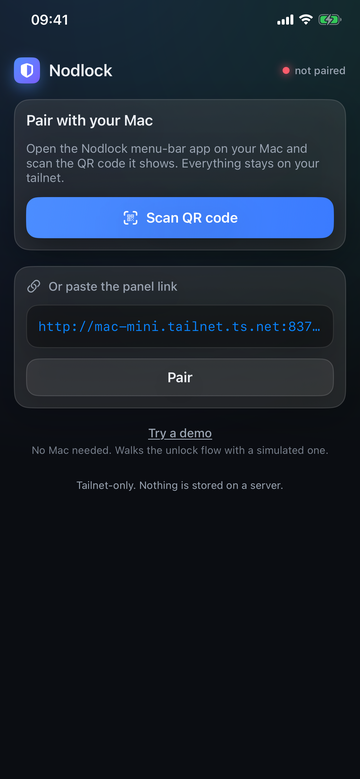
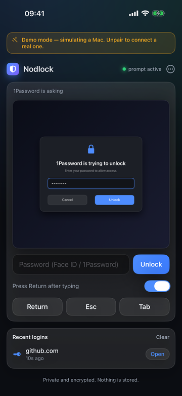
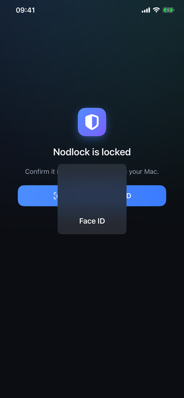
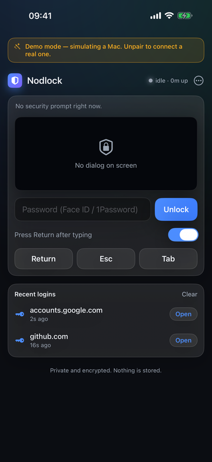
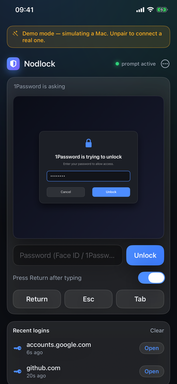
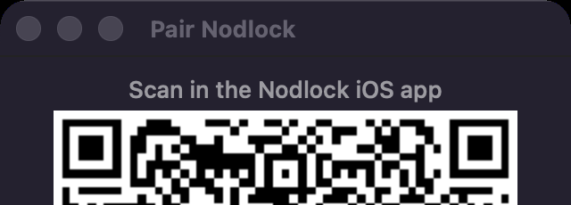
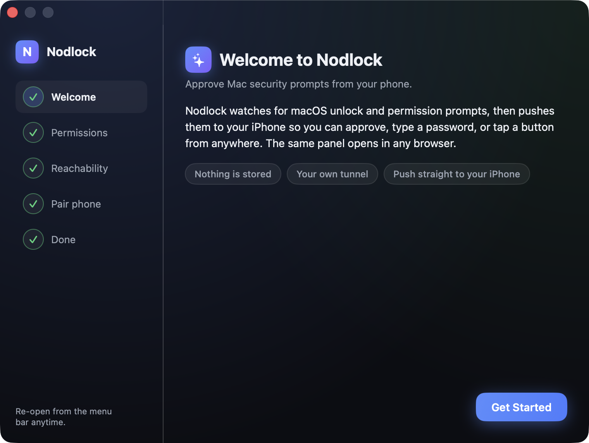
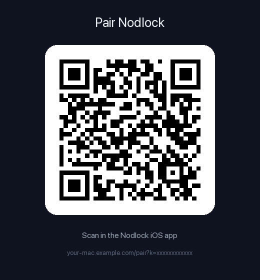

# Nodlock

Approve macOS security prompts from your phone. When your Mac throws up a
1Password unlock, a SecurityAgent password box, or a keychain prompt, Nodlock
screenshots it, pushes you a notification, and gives you a panel where you tap
the dialog and type the password with Face ID plus 1Password autofill. Works
when you are across the room and when you are across an ocean.

It also catches auth URLs. Point `$BROWSER` at the `push-url` shim and any
device-code, OAuth or SSO link an agent opens lands on your phone as a tappable
link, instead of a browser window you are not sitting in front of.


## Screenshots

**iPhone** (shown in the built-in demo mode):

| Pair | Prompt arrives | Face ID | Unlocked | Recent logins |
|---|---|---|---|---|
|  |  |  |  |  |

**Mac** (menu-bar app):

| Menu bar | Setup | Pairing QR |
|---|---|---|
|  |  |  |

<sub>The pairing QR above uses a placeholder URL; the real one carries your private pairing token and is only ever shown on your own Mac.</sub>

## Architecture

```
   ┌──────────────────── your Mac ────────────────────┐
   │                                                  │
   │   Nodlock.app (menu bar, LSUIElement)            │
   │     ├─ Watcher      spots the security dialog    │
   │     ├─ Capture      ScreenCaptureKit screenshot  │
   │     ├─ Input        CGEvent click / keystrokes   │
   │     └─ HTTP panel   binds 127.0.0.1:8377         │
   │              │                    │              │
   └──────────────│────────────────────│──────────────┘
                  │                    │
        push (title only)         panel traffic
                  │                    │
                  ▼                    ▼
            ┌──────────┐      ┌──────────────────┐
            │  Apple   │      │ Cloudflare Tunnel│
            │   APNs   │      │   + Access       │  (optional)
            └────┬─────┘      └────────┬─────────┘
                 │                     │
                 └────────┬────────────┘
                          ▼
                 ┌──────────────────┐
                 │  Nodlock (iOS)   │
                 │  Face ID · QR    │
                 └──────────────────┘
```

Two channels, on purpose. APNs carries only a title and the prompt's owner, so
Apple never sees a screenshot or a password. The screenshot and the keystrokes
travel over the panel connection, which terminates on loopback on your Mac.

Skip the tunnel if you do not need remote access. Any address your phone can
already reach (LAN IP, a VPN address) works as `SENTINEL_URL`.

## Prerequisites

- **macOS 14+** and the **Xcode command line tools** (`xcode-select --install`).
  The Mac app is Swift 6, arm64, no third-party dependencies.
- **Xcode** and an **Apple Developer account** ($99/yr) for the iOS app. Push
  notifications do not work on the simulator or with a free provisioning
  profile, so you need a real team and an **APNs key** (`.p8`) from
  developer.apple.com.
- **Optional: a Cloudflare account and a domain** if you want the panel
  reachable from outside your network. Free tier is enough.

## Before you build

The repo ships with placeholder identifiers. Change them, or code signing will
fight you:

- `NodlockMac/build-app.sh` sets `BUNDLE_ID`. Make it yours, e.g.
  `com.example.sentinel`.
- `NodlockiOS/project.yml` sets the iOS bundle id, e.g.
  `com.example.sentinel.ios`. Re-run `xcodegen generate` after editing.
- The Mac app ad-hoc signs by default. For a real identity:
  `SIGN_IDENTITY="Developer ID Application: Your Name (TEAMID)" ./install.sh`.
- The LaunchAgent label defaults to `com.example.sentinel`. Override it:
  `SENTINEL_LABEL=com.yourname.sentinel ./install.sh`.

## Quickstart

```bash
git clone <this repo> && cd op-guard
./install.sh
```

`install.sh` checks prerequisites, creates `~/.config/op-guard/`, writes the env
file, builds `Nodlock.app`, installs it to `~/Applications`, loads the
LaunchAgent, and opens the two Privacy panes. Re-running it is safe: it never
overwrites a value you already set.

Then:

1. **Grant two permissions.** System Settings > Privacy & Security. Enable
   Nodlock under **Screen Recording** and **Accessibility**. Screen Recording
   only takes effect after a relaunch:
   `launchctl kickstart -k gui/$UID/com.example.sentinel`.
2. **Build the iOS app.** Open `NodlockiOS/` in Xcode, pick your team, add the
   *Push Notifications* and *Background Modes > Remote notifications*
   capabilities, run it on your phone. See `NodlockiOS/README.md`.
3. **Wire up APNs.** Create a key at developer.apple.com > Keys with the APNs
   service enabled. Save the download as
   `~/.config/op-guard/apns/AuthKey_<KEY_ID>.p8`, then uncomment and fill the
   `OPG_APNS_*` lines in `~/.config/op-guard/env`. Use `OPG_APNS_ENV=sandbox`
   for a debug build, `production` for TestFlight.
4. **Optional: expose the panel.** Run a Cloudflare Tunnel to
   `http://127.0.0.1:8377` and set `SENTINEL_URL` to the public https hostname.
5. **Pair.** Menu bar > **Setup…** walks the wizard and shows a QR. Scan it in
   the iOS app. Host and token land in the iOS Keychain.

## Config

Everything lives in `~/.config/op-guard/` (mode 0700):

| File | What |
| --- | --- |
| `env` | `KEY=VALUE` lines, `export ` prefix allowed. Read at launch. |
| `panel-token` | 32 hex chars. The app generates it on first run, mode 0600. |
| `apns/AuthKey_<KEY_ID>.p8` | Your APNs signing key. |
| `cf-service-token.json` | Optional Cloudflare Access service token, `{client_id, client_secret}`. |
| `push-url-filter` | Optional extra regexes for the `$BROWSER` shim. |

Env keys that matter: `SENTINEL_BIND` (default `127.0.0.1`), `SENTINEL_PORT`
(default `8377`), `SENTINEL_URL` (what the pairing QR encodes),
`OPG_APNS_TEAM_ID`, `OPG_APNS_KEY_ID`, `OPG_APNS_BUNDLE_ID`, `OPG_APNS_ENV`.

## The push-url shim

`push-url` is a `$BROWSER` drop-in. It always opens the URL locally, and *also*
pushes it to your phone when the URL looks like an auth flow: `user_code=`,
`/oauth`, `/authorize`, `/sso/`, device-code endpoints, Okta, Auth0, Google,
Microsoft, AWS SSO, Cloudflare Access. Everything else opens silently, so it is
safe to set globally.

```bash
cp push-url ~/.local/bin/
export BROWSER="$HOME/.local/bin/push-url"
push-url --test          # prints which sample URLs would push
```

Add your own patterns, one extended regex per line, in
`~/.config/op-guard/push-url-filter`.

## Health watches

Nodlock can also watch the services you run on the Mac. List them in
`~/.config/op-guard/watches.json` (URLs, ports, processes, launchd jobs, tmux
windows, shell commands). Every 60 s it checks them, shows them in the menu and
the panel, and pushes once when a watch goes down and once when it recovers.
A watch can carry a `fix` command that the panel's Fix button runs. Only the
command in your local file runs, and every run is logged.

The state lands in `~/.local/state/nodlock/health.json`, so a coding agent can
run `nodlockctl health` and know what broke. Field meanings, watch types and
what to do per status: [docs/HEALTH.md](docs/HEALTH.md).

## Status server (optional)

A small Docker container that joins your tailnet, checks your URLs the way the
phone sees them, and alerts when the Mac stops sending heartbeats. You host it
yourself. Setup: [server/README.md](server/README.md), then menu bar >
**Setup…** > **Status server** to paste the address and token.

## Security model

- **The panel binds loopback.** `127.0.0.1:8377`. Nothing listens on a routable
  interface. Remote access is a tunnel's job, and the tunnel is yours.
- **Panel token.** 16 random bytes from `SecRandomCopyBytes`, hex, mode 0600.
  Every request carries `?k=<token>`. The pairing QR is the only place it is
  ever displayed.
- **Cookie, not just a query string.** Loading `/` with a valid token sets
  `sk=<token>` as `HttpOnly; SameSite=Strict`, so a forged cross-origin POST
  cannot ride along.
- **Cloudflare Access in front.** Put an Access policy on the tunnel hostname
  and the panel is behind your identity provider, not just a bearer token. Mint
  a service token, drop it in `cf-service-token.json`, and the pairing QR
  carries `cfid`/`cfsecret` so the iOS app sends the
  `CF-Access-Client-Id`/`CF-Access-Client-Secret` headers automatically.
- **Screenshots never leave the Mac.** APNs payloads carry a title and the
  prompt's owner. The image is served from the panel, on demand, over your own
  connection.
- **Passwords transit, never persist.** A password goes phone > panel >
  `CGEvent` keystrokes into the dialog. It is not written to disk, not logged,
  not cached.
- **Face ID on the phone.** The unlock screen sits behind LocalAuthentication
  and re-locks when the app backgrounds. Pairing lives in the iOS Keychain.
- **TCC identity is the app's.** Screen Recording and Accessibility are granted
  to `Nodlock.app` once. They stick across restarts because the bundle, not a
  Python interpreter, holds them.

Run one watcher at a time. Anything else already on `127.0.0.1:8377` will make
Nodlock fail to bind.

## Repo layout

```
install.sh          one-command installer (idempotent)
push-url            $BROWSER shim: auth URLs to your phone
NodlockMac/         the Mac menu-bar app (Swift 6, SwiftPM)
  build-app.sh      swift build + bundle assembly + codesign
  Sources/Nodlock/  Watcher, Capture, Input, HTTPServer, Panel, APNs, Onboarding, Health
  Tests/            swift test
server/             optional status server (Docker, Python stdlib)
docs/HEALTH.md      health watches reference
NodlockiOS/         the native iOS client (SwiftUI, XcodeGen)
```

## Troubleshooting

- **No push on the phone.** Check `OPG_APNS_ENV`. A debug build from Xcode is
  `sandbox`; TestFlight and the App Store are `production`. Wrong value fails
  silently. Then check `/tmp/nodlock.out`.
- **Panel loads but the screenshot is blank.** Screen Recording was granted
  after launch. Relaunch:
  `launchctl kickstart -k gui/$UID/com.example.sentinel`.
- **Clicks and typing do nothing.** Accessibility is not granted, or it is
  granted to an old copy of the bundle. Remove Nodlock from the list, re-add
  the one in `~/Applications`.
- **Phone cannot reach the panel.** `SENTINEL_URL` is probably still
  `http://127.0.0.1:8377`. Set it to the tunnel hostname and re-pair, since the
  old QR encodes the old address.

## Changelog / notes

- Early versions pushed through Ntfy and exposed the panel over Tailscale.
  Both are gone. Notifications now go through APNs to the native iOS app, and
  remote access is a Cloudflare Tunnel you run yourself.
